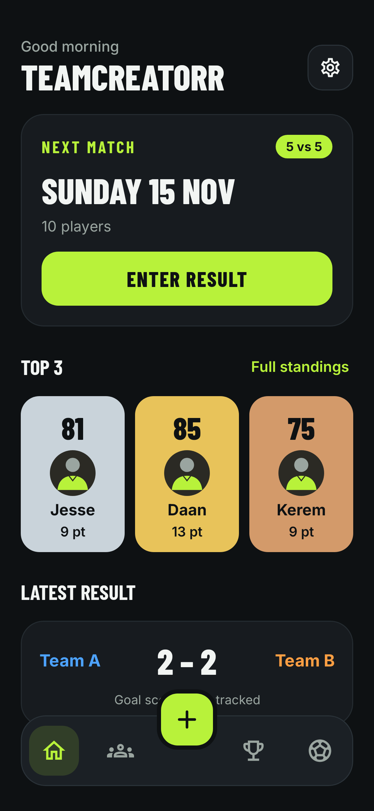
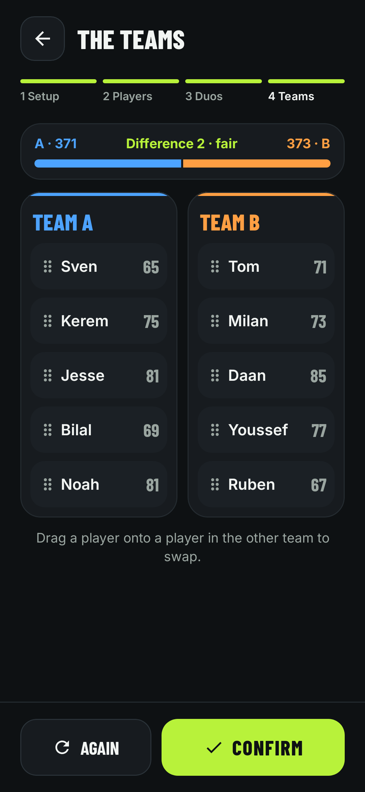
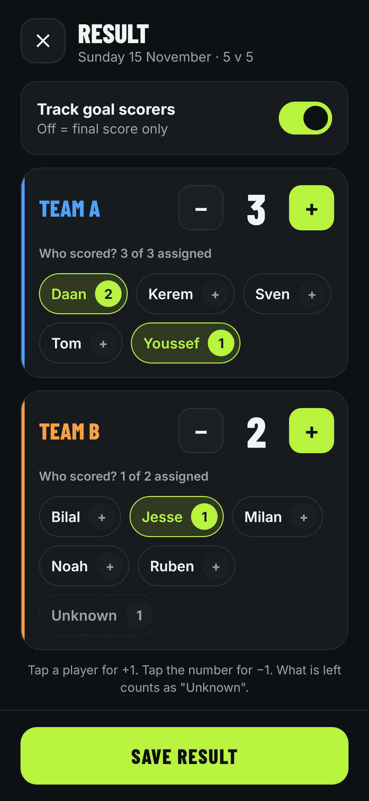
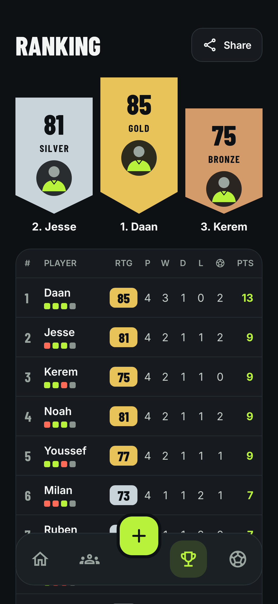

# TeamCreatorr ⚽

**Fair teams, results and standings for your weekly futsal group. Fully offline.**

---

## Features

- **Fair teams in seconds.** Pick who plays and TeamCreatorr splits them into two even teams based on each player's rating. A strength bar shows how even it is.
- **Duos.** Keep two players together, or always against each other.
- **Drag to swap.** Not happy with a team? Drag a player onto a player in the other team and they swap places.
- **Results and goal scorers.** Enter the score with − and +, and tap players to give them goals. Goals you don't assign count as "Unknown". You can also skip the scorers and save only the final score.
- **Standings.** Players earn points for attendance, draws and wins (you choose how many). Corrections, form and goals per player are all included.
- **FC-style rating (55–95).** Every player gets a card with a rating and four attributes: WIN, FORM, GOALS and DEFENCE. The [user guide](USER_GUIDE.md) explains how it works.
- **Share with your group.** Send the line-up, the result and the standings as an image. Nothing is ever sent automatically.
- **Light and dark theme**, in **English, Dutch and Turkish**.
- **Backups.** Save everything to one file and restore it on a new phone.

## Screenshots

| Home | Teams | Result | Standings |
|---|---|---|---|
|  |  |  |  |

## Install

1. On your Android phone (Android 8.0 or newer), tap the **Download** badge above. You can also open the [latest release](https://github.com/notoriouzz/TeamCreatorr/releases/latest) and download **TeamCreatorr.apk**.
2. Open the file. Android may ask you to allow installing apps from this source; allow it once. If Google Play Protect warns about an unknown app, tap **More details → Install anyway**. You only see this warning because the app doesn't come from the Play Store.
3. Open **TeamCreatorr** and add your players.

**Updating:** download the new `TeamCreatorr.apk` and install it over the old one. Your data stays.

### Coming from version 1.x?

Version 2.0 uses a new signing key, so it can't be installed over 1.x:

1. In the old app, make a backup (export).
2. Uninstall the old app.
3. Install TeamCreatorr 2.0.
4. Restore your backup (Settings → Restore backup).

## Privacy

TeamCreatorr has no account, no internet permission, no ads and no tracking. Everything stays on your phone, and profile photos never leave it. Read the full [privacy statement](PRIVACY.md).

## Support

Enjoying the app? You can buy me a coffee on [Ko-fi](https://ko-fi.com/tartaruzz). Found a problem? Open an issue in this repository.

## License

© 2026 Notoriouzz. All rights reserved. The app is free to download and use. The source code is not public and may not be copied, modified or redistributed. The open-source components used in the app are listed under **Settings → Open-source components**.
